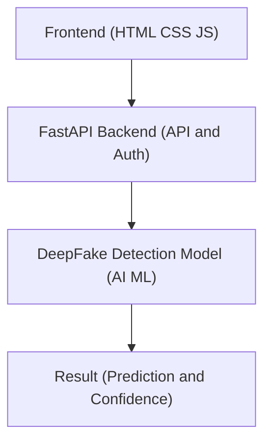

# 🕵️ DeepFake Detection Tool

An AI-powered web application that detects **deepfake content** across **images, videos, and audio**.  
The system uses a **custom-trained deep learning model** exposed via a **FastAPI backend**, with a lightweight web-based frontend for real-time analysis.

---

## 🤗 Hugging Face Space (Live Demo)

A live, interactive demo of the **DeepFake Detection Tool** is hosted on **Hugging Face Spaces**, allowing users to test the model directly from the browser without local setup.

🔗 **Hugging Face Space:**  
[DeepFake Detection Tool – Live Demo](https://huggingface.co/spaces/Tophet12/deepfake-detector)

## 🚀 Features

- 🔍 Image DeepFake Detection  
- 🎥 Video DeepFake Detection *(planned – UI only)*  
- 🎧 Audio DeepFake Detection *(planned – UI only)*  
- ⚡ FastAPI-based backend  
- 🌐 Web frontend (HTML, CSS, JavaScript)  
- ☁️ Cloud deployment (Hugging Face)  
- 🔐 Secure API-key based access  

---

## 🧠 How It Works

1. User uploads an image, video, or audio file
2. Frontend sends the file to the FastAPI backend
3. Backend processes the input using a trained AI model
4. The model analyzes deepfake artifacts and inconsistencies
5. Result is returned as **Real/Fake** with a confidence score

---

## 🏗️ System Architecture

---

## 🛠️ Tech Stack

### Frontend
- HTML5
- CSS3
- JavaScript (Vanilla)
- Font Awesome

### Backend
- Python 3.10+
- FastAPI
- Uvicorn

### AI / ML
- PyTorch + Hugging Face Transformers
- Pretrained image classifier [`prithivMLmods/deepfake-detector-model-v1`](https://huggingface.co/prithivMLmods/deepfake-detector-model-v1)
- NumPy / Pillow

### Deployment
- Render (Backend & Model)
- GitHub (Version Control)

---

## ⚙️ Installation & Local Setup

```bash
git clone https://github.com/applejuice093/Deepfake-Detector.git
cd Deepfake-Detector
make install        # pip install -r requirements.txt
make run            # uvicorn main:app --reload --port 8000
```

Open http://localhost:8000. The model weights are downloaded from Hugging Face
on the first analysis request.

### Docker

```bash
make docker-build
make docker-run
```

### Configuration

| Variable        | Default                                     | Purpose                        |
|-----------------|---------------------------------------------|--------------------------------|
| `MODEL_NAME`    | `prithivMLmods/deepfake-detector-model-v1`  | Hugging Face model to load     |
| `MAX_UPLOAD_MB` | `10`                                        | Maximum upload size in MB      |

---

## 🔌 API

| Method | Path          | Description                          |
|--------|---------------|--------------------------------------|
| GET    | `/api/health` | Health check                         |
| POST   | `/analyze`    | Multipart upload, form field `file`  |

`/analyze` returns `overall_score` (0–100, probability the image is fake),
`risk_level` (Low < 30 ≤ Medium < 60 ≤ High) and `indicators`.
Errors: `400` empty/corrupt image, `413` file too large, `415` not an image.
Uploaded files are deleted right after inference.

## 📁 Supported Formats

| Media Type | Formats              | Status                     |
| ---------- | -------------------- | -------------------------- |
| Image      | JPG, PNG, WEBP       | ✅ Supported               |
| Video      | MP4, MOV             | 🚧 UI only – not yet in API |
| Audio      | WAV, MP3             | 🚧 UI only – not yet in API |

## 🧪 Running Tests

```bash
make install-dev
make test
```

The tests stub out the model, so they run quickly without downloading weights.

---

⭐ If you find this project useful, consider starring the repository!
